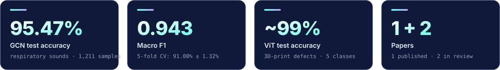
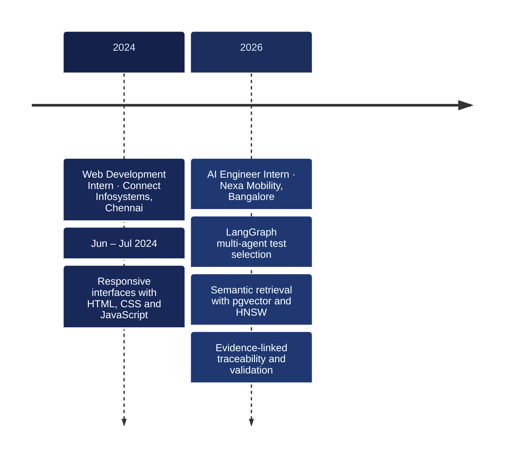
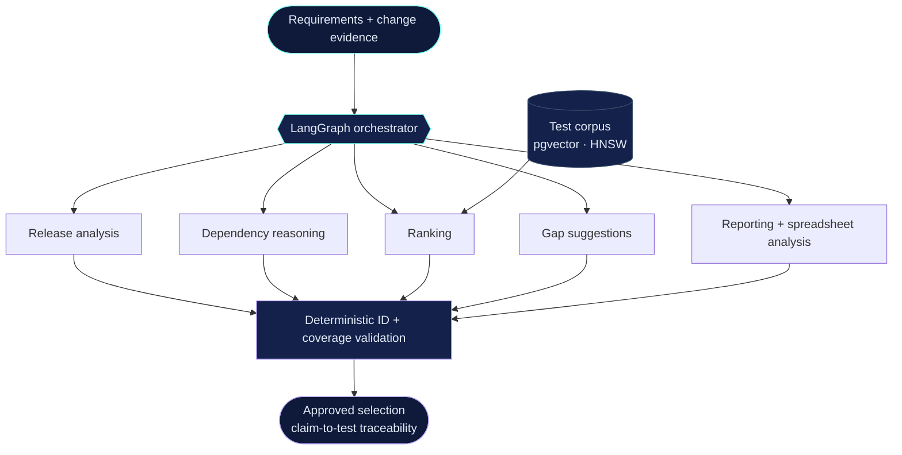
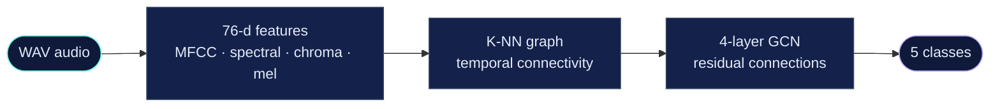
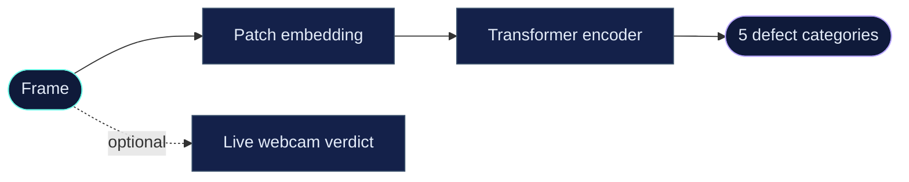
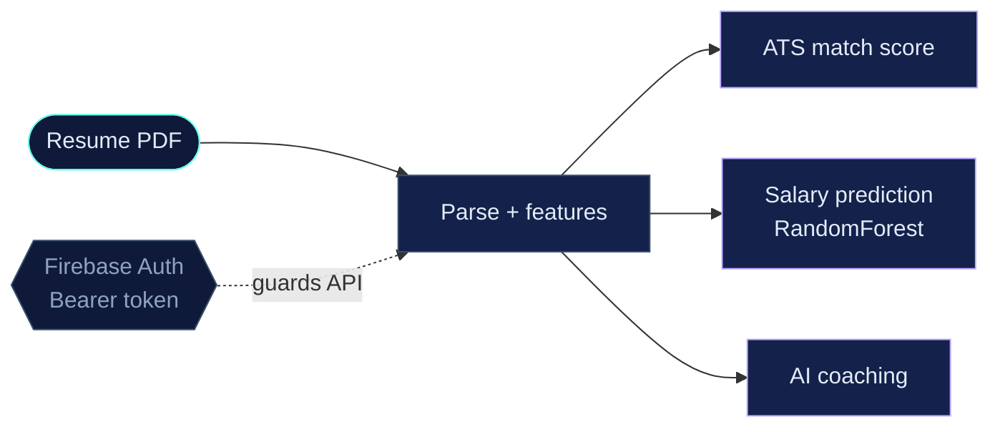

 

 

 

## `> whoami`

I'm a final-year B.Tech student in **AI & Data Science** at Saveetha Engineering College, Chennai, and an **AI Engineer Intern at Nexa Mobility**. I build models that exploit structure (graphs, image patches, embeddings) and wrap them in products people can actually use.

| | |
|:--|:--|
| **Right now** | Multi-agent LLM workflows that turn release changes into explainable, validated test selections |
| **Published** | Elsevier, *Measurement: Energy* (2026) |
| **Under review** | GNN respiratory classification, ViT 3D-print defect detection |
| **Open to** | Internships, research collaborations and ML engineering roles |

> **Reporting standard.** Every number here is one I measured. When the headline result and the cross-validated result disagree, I show both.

## `> experience`

#### 2026 · AI Engineer Intern, Nexa Mobility

- Built an AI workflow that converts release requirements and software-change evidence into explainable, validated test selections.
- Designed a **LangGraph multi-agent system** with specialised agents for release analysis, dependency reasoning, ranking, gap suggestions, reporting and spreadsheet analysis.
- Implemented semantic retrieval over a structured test corpus with Sentence Transformers, pgvector/HNSW and cosine similarity, backed by deterministic ID and coverage validation.
- Added claim-to-test traceability, bounded retries, concurrency controls, and separate validation and approval states.

<b>View the workflow</b>

#### Jun – Jul 2024 · Web Development Intern, Connect Infosystems

- Built responsive web interfaces with HTML, CSS and JavaScript and worked through frontend workflows and production deployment.

## `> projects`

### 01 · Respiratory sounds as a graph

*A lung recording is not an isolated clip. What if neighbouring samples could inform each other?*

**95.47%** test accuracy · **0.943** macro F1 · **91.00% ± 1.32%** 5-fold CV · 1,211 samples
Deployed as a React + Express + Flask app: upload a WAV, get a prediction in real time.

`PyTorch Geometric` · `Librosa` · `Flask` · `Express` · `React` | Manuscript under review | [Code →](https://github.com/Shashank2006offl/REPO-NAME)

 

### 02 · Catching failed prints with a Vision Transformer

*Print defects are local texture failures, which is exactly what patch-based attention is good at.*

**~99%** test accuracy on a custom 1,000+ image dataset, shipped with a Flask interface and optional webcam capture.

`TensorFlow` · `Keras` · `OpenCV` · `Flask` | Manuscript under review | [Code →](https://github.com/Shashank2006offl/REPO-NAME)

 

### 03 · LuminaRole.ai, a resume analyser

*One PDF in; ATS fit, salary estimate and coaching out.*

Salary model trained on Data Science job-market data; the API is protected with Firebase authentication.

`React` · `Flask` · `scikit-learn` · `Firebase` | [Code →](https://github.com/Shashank2006offl/REPO-NAME)

## `> research`

| Status | Paper | Venue |
|:--|:--|:--|
| **Published** | *Adaptive AI Scheduling of Building HVAC to Charge Phase Change Thermal Batteries with Elevator Regenerative Braking Heat*, Rajagopal M., **Shashank R.** | *Measurement: Energy*, Elsevier, 2026 |
| In review | *GNN-Powered Respiratory Disease Detection* | Manuscript |
| In review | *3D Printer Defect Detection using Vision Transformers* | Manuscript |

## `> stack`

| Area | Tools |
|:--|:--|
| **Languages** |     |
| **Deep learning** |  -0b132b?style=flat-square&logo=pytorch&logoColor=6FFFE9)   |
| **ML + data** |     -0b132b?style=flat-square&logoColor=6FFFE9) |
| **GenAI + agents** |     |
| **Retrieval + data stores** |    |
| **Backend + frontend** |     |
| **Tooling** |    |

## `> education`

| | |
|:--|:--|
| **B.Tech, Artificial Intelligence & Data Science** | Saveetha Engineering College, Chennai · 2023 – 2027 |
| **Higher Secondary (CBSE, Science)** | 2021 – 2023 |
| **Coursework** | Machine Learning, Deep Learning, Graph Neural Networks, Computer Vision, Data Analytics, Statistics, Neural Networks |
| **Certifications** | Foundations and Core Concepts of PyTorch (Coursera) · Machine Learning 101 (GUVI) · Data Analytics Using Pandas (GUVI) |

### Have a hard modelling problem or a research idea?

[**Portfolio**](https://shashank-portfolio-c46v.vercel.app) &nbsp;·&nbsp; [**LinkedIn**](https://linkedin.com/in/shashank-r) &nbsp;·&nbsp; [**r8013938@gmail.com**](mailto:r8013938@gmail.com)

