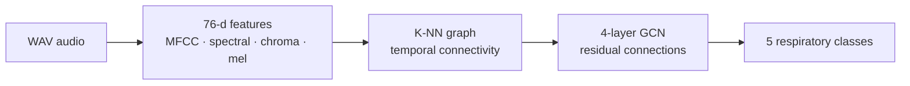
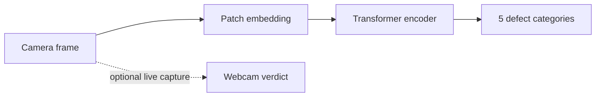
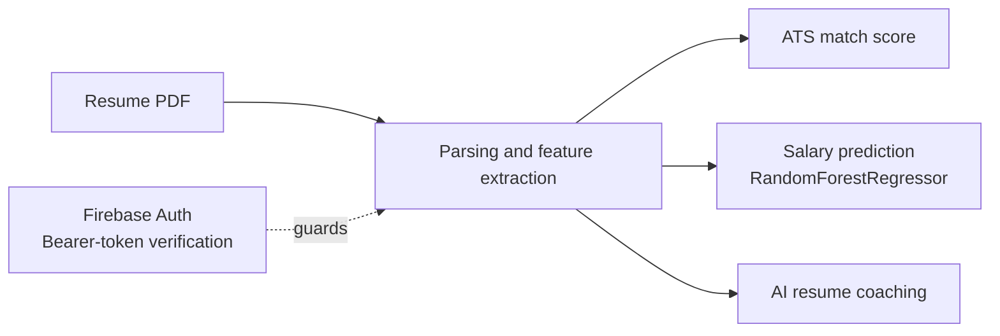
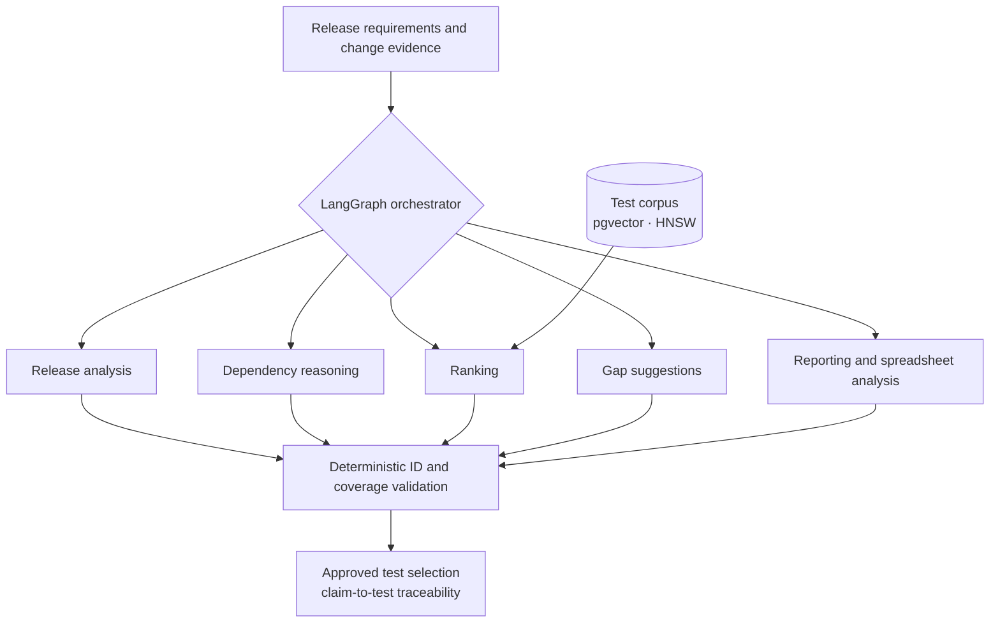

# Shashank R

**AI / ML engineer** · Graph neural networks · Vision transformers · Retrieval and agentic systems

I build machine-learning systems that are measured honestly, deployed end to end, and able to explain their own decisions.

B.Tech, Artificial Intelligence & Data Science, Saveetha Engineering College, Chennai (2023 – 2027)

[Portfolio](https://shashank-portfolio-c46v.vercel.app) · [LinkedIn](https://linkedin.com/in/shashank-r) · [Email](mailto:r8013938@gmail.com)

---

## At a glance

| | |
|---|---|
| **Currently** | AI Engineer Intern at Nexa Mobility, building multi-agent LLM workflows for enterprise test selection |
| **Published** | 1 peer-reviewed paper, *Measurement: Energy* (Elsevier, 2026) |
| **In review** | 2 manuscripts: GNN respiratory sound classification, ViT 3D-print defect detection |
| **Focus** | Structure-aware models (GNNs), vision transformers, semantic retrieval, LLM agents |
| **Open to** | Research collaborations and ML engineering roles |

---

## Working principle

> A model result is only useful if someone else can trust it.

Every figure in this profile is one I measured. Where a headline number and a cross-validated number disagree, I report both.

---

## Selected work

### 1. Graph-based respiratory sound classification

**Question.** Do respiratory recordings carry relational structure that clip-by-clip classifiers discard?

| Metric | Value |
|---|---|
| Test accuracy | **95.47%** |
| Macro F1 | **0.943** |
| 5-fold CV accuracy | **91.00% ± 1.32%** |
| Samples | 1,211 |

The gap between test accuracy and cross-validation is reported deliberately. Shipped as a full-stack app: upload a WAV file, get a prediction in real time.

`PyTorch Geometric` `Librosa` `Flask` `Express` `React` · Manuscript under review · [Code](https://github.com/Shashank2006offl/REPO-NAME)

---

### 2. Vision-transformer defect detection for 3D printing

**Question.** If print failures are local texture defects, can a patch-based transformer separate them reliably?

| Metric | Value |
|---|---|
| Test accuracy | approx. **99%** |
| Dataset | Custom, 1,000+ images, 5 categories |

Deployed behind a Flask interface with optional webcam-based live capture.

`TensorFlow` `Keras` `OpenCV` `Flask` · Manuscript under review · [Code](https://github.com/Shashank2006offl/REPO-NAME)

---

### 3. LuminaRole.ai, ML-powered resume analyser

**Question.** How much actionable signal can a single PDF yield?

An end-to-end career analytics platform. The salary model is trained on Data Science job-market data; the API is protected by Firebase authentication with Bearer-token verification.

`React` `Flask` `scikit-learn` `Firebase` · [Code](https://github.com/Shashank2006offl/REPO-NAME)

---

### 4. Industry work: explainable test selection with multi-agent LLMs

At **Nexa Mobility** I work on a workflow that turns release requirements and software-change evidence into validated, explainable test selections.

What matters to me in this system:

- **Retrieval you can audit.** Sentence Transformers embeddings, pgvector with HNSW indexing, cosine similarity, followed by deterministic ID and coverage checks.
- **Evidence-linked outputs.** Every selected test traces back to the claim and change evidence that justified it.
- **Reliability controls.** Bounded retries, concurrency limits, and separate validation and approval states.

---

## Research

| Status | Title | Venue |
|---|---|---|
| Published | *Adaptive AI Scheduling of Building HVAC to Charge Phase Change Thermal Batteries with Elevator Regenerative Braking Heat* (Rajagopal M., **Shashank R.**) | *Measurement: Energy*, Elsevier, 2026 |
| Under review | *GNN-Powered Respiratory Disease Detection* | Manuscript |
| Under review | *3D Printer Defect Detection using Vision Transformers* | Manuscript |

---

## Technical stack

| Area | Tools |
|---|---|
| **Modelling** | PyTorch, PyTorch Geometric, TensorFlow, Keras, scikit-learn · GNNs, CNNs, ViTs, Random Forests |
| **GenAI and agents** | LangGraph, LangChain, RAG, multi-agent systems, LLM APIs |
| **Retrieval** | Sentence Transformers, pgvector, HNSW, Supabase |
| **Backend** | FastAPI, Flask, Express |
| **Frontend** | React, TypeScript, JavaScript, HTML, CSS |
| **Data and signals** | NumPy, Pandas, Librosa, OpenCV |

<b>Background and coursework</b>

 

- **Education:** B.Tech in Artificial Intelligence & Data Science, Saveetha Engineering College (2023 – 2027). Higher Secondary (CBSE, Science), 2021 – 2023.
- **Experience:** AI Engineer Intern, Nexa Mobility. Web Development Intern, Connect Infosystems, Chennai (Jun – Jul 2024).
- **Coursework:** Machine Learning, Deep Learning, Graph Neural Networks, Computer Vision, Data Analytics, Statistics, Neural Networks.
- **Certifications:** Foundations and Core Concepts of PyTorch (Coursera); Machine Learning 101 and Data Analytics Using Pandas (GUVI).

---

## Get in touch

Open to research collaborations, ML engineering roles, and problems where the evaluation is as interesting as the model.

[Portfolio](https://shashank-portfolio-c46v.vercel.app) · [LinkedIn](https://linkedin.com/in/shashank-r) · [r8013938@gmail.com](mailto:r8013938@gmail.com)
